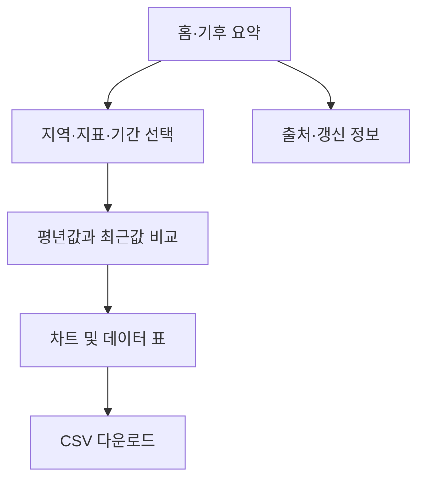
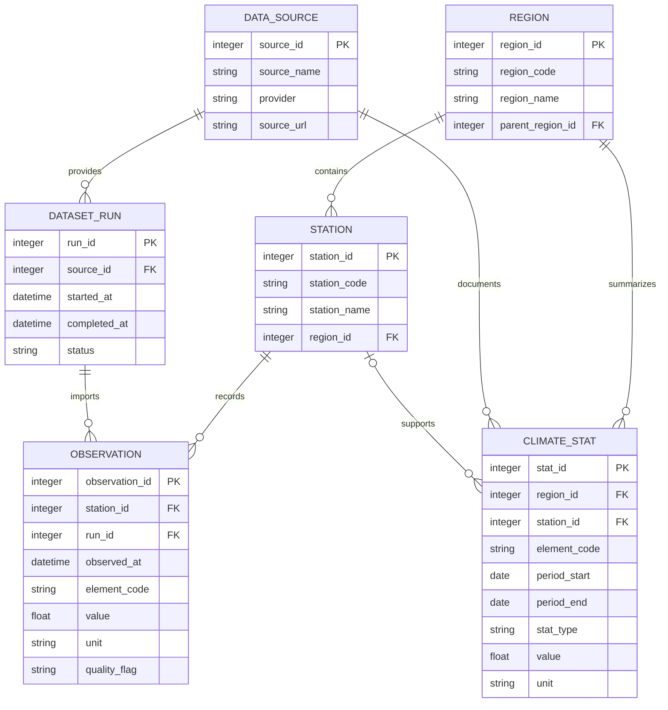

# 우리 지역의 기후는 어떻게 변하고 있을까요?

> 전국 17개 시·도의 공식 기후 자료를 살펴보고, 기후 평년값과 최근 완결 연도의 차이를 비교하는 초급자용 Python·Streamlit 시제품입니다.

## 1. 프로젝트 개요

이 프로젝트는 공식 기후 데이터를 수집·정리해 지역별 기후 특성을 이해하기 쉽게 보여 주는 학습용 웹 앱입니다. 사용자는 지역과 지표를 선택하고, 평년값과 최근 연도 값을 비교하며, 결과를 차트·표로 확인하고 CSV로 내려받습니다.

- 대상: 기상·기후 데이터 분석 입문자 및 일반 사용자
- 지역 범위: 전국 17개 시·도
- 비교 기준: 기후 평년값(기본 기준 1991~2020년)과 최근 완결 연도
- 구현 방향: Python, Streamlit, pandas, Plotly, SQLite
- 초기 범위: 지역·지표 선택, 기후 요약, 평년/최근값 비교, 지역 비교, 출처 표시, CSV 다운로드

**현재 상태:** 이 문서는 기획·설계 초안입니다. 데이터 수집, DB 적재, 화면 기능은 구현 후 실제 자료와 테스트로 검증합니다.

## 2. 기능정의서

| ID | 기능 | 설명 | 입력 | 출력 | 우선순위 |
|---|---|---|---|---|---|
| F-01 | 지역 선택 | 17개 시·도 중 한 곳 또는 여러 곳 선택 | 시·도 | 선택 지역 | 필수 |
| F-02 | 기후 지표 선택 | 지원되는 기후 지표 선택 | 지표 코드 | 지표별 결과 | 필수 |
| F-03 | 기간 선택 | 평년 기준 및 비교할 최근 완결 연도 선택 | 기간·연도 | 비교 기간 | 필수 |
| F-04 | 기후 요약 | 핵심 수치와 단위 표시 | 지역·지표·기간 | 요약 카드 | 필수 |
| F-05 | 평년값 비교 | 평년값, 최근값, 차이 표시 | 조회 조건 | 값·편차 | 필수 |
| F-06 | 시각화 | 지역·기간별 차트를 표시 | 조회 조건 | 선·막대 차트 | 필수 |
| F-07 | 지역 간 비교 | 동일 지표·기간으로 여러 지역 비교 | 복수 지역 | 비교 차트·표 | 필수 |
| F-08 | 데이터 표 | 실제 비교에 사용한 값과 단위 표시 | 조회 조건 | 표 | 필수 |
| F-09 | CSV 다운로드 | 조회 결과 파일 저장 | 조회 결과 | CSV | 필수 |
| F-10 | 출처·갱신 정보 | 출처, 기준 기간, 수집 시점 표시 | 메타데이터 | 출처 안내 | 필수 |
| F-11 | 수집·정제 | 원자료 수집, 형식 통일, 품질 점검 | API·파일 | 정제 자료 | 확장 |
| F-12 | 오류 안내 | 데이터 없음·수집 실패 시 안내 | 오류 상태 | 안내 메시지 | 필수 |

### 처리 규칙
1. 지역 간 비교에는 같은 지표, 단위, 기간 기준을 적용합니다.
2. 차이는 ‘최근 연도 값 - 평년값’으로 계산합니다.
3. 지표 단위와 집계 방식(연평균, 연합계 등)을 표시합니다.
4. 미완결 연도는 완결 연도와 구분합니다.
5. 결측값을 0으로 바꾸지 않습니다. 품질 상태를 표시하고 계산 규칙을 명시합니다.
6. 관측값, 평년 통계, 계산한 편차를 구분합니다.

## 3. 화면구성도 및 설계

### 화면 흐름



### 화면 목록

| 화면 ID | 화면명 | 주요 구성 | 사용자 동작 |
|---|---|---|---|
| S-01 | 홈·기후 요약 | 서비스 소개, 핵심 지표 카드, 기준 안내 | 분석 시작 |
| S-02 | 조회 조건 | 시·도, 지표, 기간 선택 | 조건 설정 후 조회 |
| S-03 | 비교 결과 | 평년값, 최근값, 차이, 단위 | 결과 확인 |
| S-04 | 차트 분석 | 지역별 막대 차트, 연도별 추세 차트 | 시각화 확인 |
| S-05 | 표·다운로드 | 데이터 표, 출처, CSV 버튼 | 조회·저장 |
| S-06 | 데이터 안내 | 자료 제공 기관, 기준 기간, 수집일, 한계 | 출처 확인 |


### 초급자용 UI 원칙
- 조회 조건을 한 영역에 모으고 선택 항목을 최소화합니다.
- 어려운 용어에는 쉬운 설명을 붙입니다.
- 숫자마다 단위와 기준 기간을 표시합니다.
- 차트와 함께 같은 값을 표로 제공합니다.
- 데이터가 없으면 이유와 다음 행동을 안내합니다.
- 색상뿐 아니라 범례·레이블·수치로 차이를 구분합니다.

## 4. DB 설계

### DBMS
초기 시제품은 별도 서버 설치가 필요 없는 SQLite를 사용합니다. 데이터 규모가 커지거나 여러 사용자의 동시 접근이 필요해지면 PostgreSQL 등으로 이전을 검토합니다.

### 논리 테이블

| 테이블 | 목적 | 주요 컬럼 |
|---|---|---|
| region | 지역 코드와 이름 | region_id PK, region_code, region_name, parent_region_id FK |
| station | 관측 지점 | station_id PK, station_code, station_name, region_id FK, latitude, longitude |
| data_source | 출처 정보 | source_id PK, source_name, provider, source_url, license_note |
| dataset_run | 수집·검수 이력 | run_id PK, source_id FK, started_at, completed_at, status, record_count, quality_note |
| observation | 기간별 관측 자료 | observation_id PK, station_id FK, run_id FK, observed_at, element_code, value, unit, quality_flag |
| climate_stat | 평년값 및 집계 통계 | stat_id PK, region_id FK, station_id FK(선택), element_code, period_start, period_end, stat_type, value, unit, source_id FK |

### ERD



### 키·무결성 규칙
- PK는 각 레코드를 고유하게 식별하고 FK로 테이블 간 관계를 유지합니다.
- 지역 코드와 관측 지점 코드는 공식 자료와 대조하고 필요한 경우 UNIQUE 제약을 둡니다.
- 관측 지점·관측 시각·요소 코드 기준으로 중복을 점검합니다.
- 값(value), 단위(unit), 품질 플래그, 출처를 함께 보존합니다.
- 실제 API 응답과 제공 기관의 사양을 확인한 뒤 컬럼과 자료형을 확정합니다.

## 5. 데이터 수집 방법

### 우선 검토할 공식 자료
- [기상청 기후정보포털](https://www.climate.go.kr/): 기후 평년값 및 기후 통계
- [기상자료개방포털](https://data.kma.go.kr/): ASOS 관측 자료 등
- [공공데이터포털](https://www.data.go.kr/): 이용 가능한 기상·기후 Open API
- 공식 행정구역 자료: 시·도 코드와 명칭 관리

자료별 제공 항목, 기간, API 이용 조건, 갱신 주기 및 재이용 조건은 구현 전에 공식 문서에서 확인합니다. 모든 지표가 하나의 API에서 제공된다고 가정하지 않습니다.

### 수집 파이프라인


### 수집 절차
1. 필요한 지표, 지역 단위, 기간, 단위, 갱신 주기를 정합니다.
2. 공식 API 또는 제공 파일을 이용하고 출처 URL, 조회 시점, 원본 파일명을 기록합니다.
3. 날짜 형식, 지역 코드, 지표 코드, 단위를 표준화합니다.
4. 누락값, 중복 행, 비정상 값, 날짜 범위, 지역 코드 불일치를 확인합니다.
5. 이상치와 단위 변환 결과를 원자료 및 공식 설명과 대조해 사람이 검수합니다. 자동 규칙만으로 실제 기후 특이 현상과 오류를 구분하기 어렵기 때문입니다.
6. 정제 자료와 수집 실행 이력을 DB에 저장합니다.
7. 동일한 기간·단위 기준으로 평년값, 최근 완결 연도 값, 차이를 계산합니다.
8. 화면과 다운로드 파일에 출처, 기준 기간, 단위, 자료 갱신일을 표시합니다.

### 품질 체크리스트
- [ ] 출처와 사용 조건 확인
- [ ] 지역 코드와 관측 지점 매핑 확인
- [ ] 날짜 범위 및 시간 단위 확인
- [ ] 결측값을 0으로 잘못 처리하지 않았는지 확인
- [ ] 중복 레코드와 단위 혼용 확인
- [ ] 평년값의 기준 기간 표시
- [ ] 최근 연도가 완결되었는지 확인
- [ ] 차트 값과 DB·원자료 일치 확인

### API 키 관리
API 키를 쓰는 경우 프로젝트 루트의 .env 파일에 보관하고 Git에 올리지 않습니다. .env.example에는 변수 이름만 적고 실제 키는 넣지 않습니다.

예시 환경 변수 이름: WEATHER_API_KEY

## 6. 개발 환경

| 구분 | 기술 | 용도 |
|---|---|---|
| 운영체제 | Windows 11 | 개발·실행 |
| 편집기 | Visual Studio Code | 코드 작성·디버깅 |
| 언어 | Python 3.x | 앱과 데이터 처리 |
| 웹 UI | Streamlit | 입력, 화면, 차트 표시 |
| 데이터 처리 | pandas | 정제·집계·비교 |
| 시각화 | Plotly | 인터랙티브 차트 |
| HTTP 요청 | requests | Open API 호출 |
| 환경 변수 | python-dotenv | API 키 등 비밀값 관리 |
| DB | SQLite | 시제품용 로컬 저장 |
| 버전 관리 | Git / GitHub | 변경 이력 |

### 권장 프로젝트 구조

```text
weather_app/
├─ app.py
├─ requirements.txt
├─ .env.example
├─ .gitignore
├─ README.md
├─ data/
│  ├─ raw/
│  └─ processed/
├─ database/
│  └─ schema.sql
├─ src/
│  ├─ collect.py
│  ├─ clean.py
│  ├─ db.py
│  └─ analysis.py
└─ tests/
   └─ test_validation.py
```

위 구조는 권장안이며, 현재 저장소에 모든 파일이 존재한다는 뜻은 아닙니다. 실제 코드 추가 단계에서 기존 파일 구성에 맞춰 확정합니다.

### Windows 11 + VS Code 실행 절차
앱 구현 후 VS Code 터미널에서 프로젝트 폴더를 연 다음 아래 명령을 순서대로 실행합니다.

1. 가상환경 생성:

   ```powershell
   py -m venv .venv
   ```

2. 가상환경 활성화:

   ```powershell
   .\.venv\Scripts\Activate.ps1
   ```

3. 패키지 설치:

   ```powershell
   python -m pip install --upgrade pip
   pip install -r requirements.txt
   ```

4. 앱 실행:

   ```powershell
   streamlit run app.py
   ```

5. 터미널에 표시된 로컬 주소를 브라우저에서 엽니다. 일반적으로 http://localhost:8501 입니다.

실행 파일과 requirements.txt가 아직 없다면 위 명령은 바로 작동하지 않을 수 있습니다. 코드 구현 시 실제 파일 이름과 패키지 목록을 이 안내와 일치시키겠습니다.

## 7. 단계별 개발 계획

| 단계 | 작업 | 완료 기준 |
|---|---|---|
| 1 | 기획·설계 검토 | 기능·화면·DB·출처 초안 승인 |
| 2 | 화면 시제품 | 샘플 데이터로 Streamlit 화면 작동 |
| 3 | DB 구현 | SQLite 저장·조회 테스트 통과 |
| 4 | 데이터 수집 | 공식 자료 수집 및 출처 기록 |
| 5 | 분석·시각화 | 평년/최근값 비교, 차트·표 일치 |
| 6 | 품질 검수 | 결측·중복·단위·지역 매핑 점검 |
| 7 | 문서·배포 | 새 환경에서 실행 방법 검증 |

## 8. 알려진 한계 및 검토 사항
- 기후 평년값과 최근 관측값은 집계 기준 및 공간 단위가 다를 수 있어 비교 가능성을 먼저 확인해야 합니다.
- 관측소 자료를 시·도 대표값으로 사용하려면 대표성 및 집계 방법을 정의해야 합니다.
- 결측·품질 플래그와 제공 기관의 수정 이력을 고려해야 합니다.
- 관측값의 변화만으로 기후 변화의 원인을 단독으로 입증할 수는 없습니다.
- 로그인, 사용자별 클라우드 저장, 자동 배포, 예약 수집은 초기 시제품 범위에 포함하지 않습니다.

## 9. 참고 자료
- [기상청 기후정보포털](https://www.climate.go.kr/)
- [기상자료개방포털](https://data.kma.go.kr/)
- [공공데이터포털](https://www.data.go.kr/)
- [Streamlit 문서](https://docs.streamlit.io/)
- [pandas 문서](https://pandas.pydata.org/docs/)
- [Plotly Python 문서](https://plotly.com/python/)
- [SQLite 문서](https://www.sqlite.org/docs.html)
