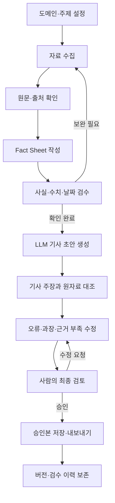
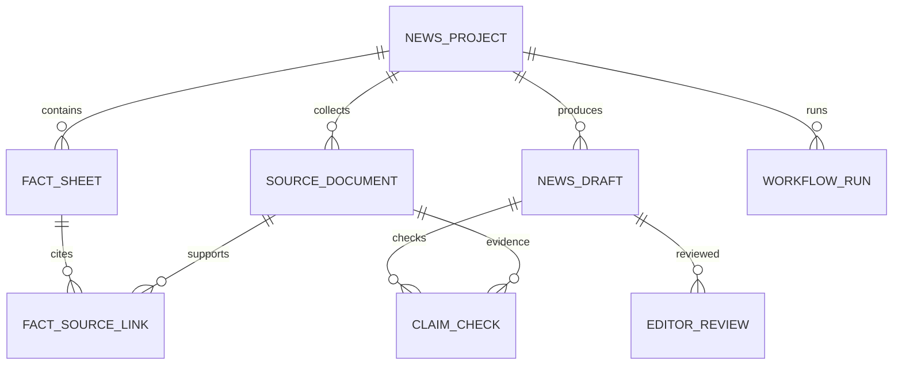

# 우리 지역의 기후는 어떻게 변하고 있을까요?

> 전국 17개 시·도의 기후 자료를 이해하기 쉽게 비교하고, 이후에는 검증 가능한 근거를 바탕으로 기후·생활 뉴스를 제작하는 과정을 설계하는 프로젝트입니다.

## 1. 프로젝트 소개

이 저장소는 두 가지 작업 흐름을 다룹니다.

1. **지역 기후 비교 대시보드**: 기후 평년값과 최근 완결 연도의 기후 지표를 비교해 지역별 차이를 살펴봅니다.
2. **근거 기반 뉴스 제작 워크플로(설계 단계)**: 주제 선정부터 자료 수집, Fact Sheet 확인, AI 초안 작성, 원자료 대조, 사람의 최종 검수까지 단계별로 관리하는 기능을 설계합니다.

이 프로젝트는 초급 개발자가 Python 기반 데이터 앱과 근거 중심 콘텐츠 제작 과정을 단계적으로 학습할 수 있도록 구성합니다.

### 현재 상태 한눈에 보기

| 영역 | 상태 | 설명 |
|---|---|---|
| 기후 대시보드 | 시제품 | Streamlit 화면이 있으며, 현재 표시되는 값은 합성 샘플 데이터입니다. |
| 공식 기후 데이터 연계 | 미구현 | 기상청 등 공식 자료의 항목·기간·이용 조건을 확인한 뒤 연결합니다. |
| 뉴스 제작·검수 워크플로 | 설계 단계 | 화면, 데이터 구조, 검수 절차를 먼저 확정합니다. |
| FastAPI 백엔드 | 제안 단계 | 뉴스 워크플로 API용 후보 기술입니다. |
| MySQL | 제안 단계 | 뉴스 제작·검수 이력 저장용 후보 DB입니다. |
| OpenAI API | 제안 단계 | 뉴스 초안 생성과 보조 검증에 사용할 후보입니다. |
| 코드 및 DB 변경 | 보류 | 설계 검토가 끝나기 전에는 신규 구현을 진행하지 않습니다. |

**중요:** 이 README는 현재 구현된 기능과 향후 제안 사항을 구분합니다. 설계 문서에 등장하는 기능이나 기술이 이미 코드에 구현되어 있다는 뜻은 아닙니다.

## 2. 목표와 범위

### 기후 비교 대시보드

- 대상 지역: 대한민국 17개 시·도
- 비교 방향: 기후 평년값과 최근 완결 연도 값 비교
- 사용자 기능: 지역·지표·기간 선택, 요약 수치, 차트·표 확인, CSV 다운로드, 출처 확인
- 사용자: 기후·데이터 분석 입문자 및 일반 독자
- 기본 평년 기준 후보: 1991~2020년. 실제 자료를 연결할 때 제공 기관의 기준 기간과 지표 정의를 확인합니다.

### 뉴스 제작·검수 워크플로

뉴스 제작 기능은 단순히 AI에게 기사를 작성하게 하는 것이 아니라, 기사에 포함된 주요 주장을 출처 자료와 대조하고 담당자가 승인하는 과정을 관리하는 것을 목표로 합니다.

- 도메인과 기사 주제 설정
- 관련 자료 검색 및 원문 확인
- 출처별 Fact Sheet 작성과 검수
- Fact Sheet를 바탕으로 AI 초안 생성
- 기사 주장과 원자료의 일치 여부 확인
- 오류·과장·근거 부족 문장 수정
- 사람의 최종 검토 및 승인
- 버전, 검수 결과, 실행 이력 보존

## 3. 기술 구성

### 현재 시제품

| 기술 | 역할 | 상태 |
|---|---|---|
| Python | 앱 및 데이터 처리 | 사용 중 |
| Streamlit | 현재 대시보드 UI | 사용 중, 기술 선택 재검토 대상에서 제외 |
| pandas | 표 데이터 처리·집계 | 사용 또는 시제품 의존성 기준 확인 |
| Plotly | 차트 시각화 | 사용 또는 시제품 의존성 기준 확인 |
| SQLite | 시제품의 로컬 저장 | 현재 코드의 저장 범위와 실제 사용을 확인하며 유지 |

### 뉴스 기능을 위한 제안 구성

| 기술 | 제안 역할 | 결정 상태 |
|---|---|---|
| FastAPI | 뉴스 워크플로 API 및 업무 로직 제공 | 설계 검토 필요 |
| MySQL | 프로젝트, 출처, Fact Sheet, 초안, 검수·버전 이력 저장 | 설계 검토 필요 |
| OpenAI API | Fact Sheet 기반 기사 초안 생성 및 보조 작업 | 모델·비용·품질 평가 필요 |
| Streamlit | 기존 대시보드 화면 계층 유지 | 사용 여부 확인 완료, 추가 검토 항목 아님 |

기후 대시보드의 기존 구조와 뉴스 제작 워크플로의 구조는 목적에 따라 분리해 검토합니다. 뉴스 기능을 위해 FastAPI와 MySQL을 도입하더라도, 그 결정만으로 기존 Streamlit 화면을 교체하거나 기후 시제품 DB를 즉시 마이그레이션하지 않습니다.

## 4. 기능 정의

### 4.1 기후 비교 대시보드

| ID | 기능 | 설명 | 우선순위 |
|---|---|---|---|
| CL-01 | 지역 선택 | 17개 시·도 중 한 곳 또는 여러 곳 선택 | 필수 |
| CL-02 | 지표 선택 | 지원하는 기후 지표 선택 | 필수 |
| CL-03 | 기간 선택 | 평년 기준과 비교할 최근 완결 연도 선택 | 필수 |
| CL-04 | 기후 요약 | 값, 단위, 기준 기간 표시 | 필수 |
| CL-05 | 평년·최근 비교 | 두 값과 차이 표시 | 필수 |
| CL-06 | 시각화 | 지역·기간별 차트 표시 | 필수 |
| CL-07 | 표·CSV | 비교에 사용한 값 조회 및 내려받기 | 필수 |
| CL-08 | 출처·갱신 정보 | 출처, 기준 기간, 수집 시점 표시 | 필수 |
| CL-09 | 데이터 품질 안내 | 결측·오류·수집 실패 상황 안내 | 필수 |

### 4.2 뉴스 제작·검수 워크플로

| ID | 기능 | 설명 | 주요 결과 |
|---|---|---|---|
| NW-01 | 프로젝트·주제 설정 | 도메인, 주제, 독자, 기사 목적 설정 | 뉴스 프로젝트 |
| NW-02 | 출처 수집 | 관련 자료의 URL, 제목, 발행일, 본문 확인 상태 기록 | 출처 목록 |
| NW-03 | 출처 검증 | 원문 접근 가능 여부, 발행 주체, 날짜, 관련성 확인 | 검증 상태 |
| NW-04 | Fact Sheet 관리 | 확인된 사실, 수치, 날짜, 인용 근거를 정리 | 검수 가능한 사실 목록 |
| NW-05 | AI 초안 생성 | 승인된 Fact Sheet를 바탕으로 초안 생성 | 초안 버전 |
| NW-06 | 주장-출처 대조 | 기사 속 핵심 주장과 원자료의 일치 여부 비교 | 주장별 검증 결과 |
| NW-07 | 수정 및 재검토 | 오류·과장·근거 부족 표현을 수정하고 다시 확인 | 수정 초안 |
| NW-08 | 사람의 최종 승인 | 담당자가 정확성, 맥락, 표현, 출처를 검토 | 승인·반려 상태 |
| NW-09 | 이력 관리 | 초안 버전, 검수 의견, 모델 및 실행 정보 보존 | 변경·감사 이력 |

## 5. 뉴스 제작 표준 흐름



### 필수 검수 원칙

1. 검색 결과의 제목이나 요약만으로 사실을 확정하지 않습니다. 가능한 경우 원문 본문을 확인합니다.
2. 사실, 수치, 날짜, 인용, 해석을 구분하고 주요 주장마다 근거 출처를 연결합니다.
3. 출처에서 확인되지 않는 내용은 사실처럼 단정하지 않습니다. 필요하면 삭제하거나 불확실성을 명시합니다.
4. AI가 작성한 초안은 자동으로 승인본이 되지 않습니다.
5. 최종 게시 여부는 사람이 결정합니다.
6. 출처 접근 실패, 중복 자료, 서로 다른 수치, 상충하는 설명은 검수 화면에서 확인할 수 있어야 합니다.
7. 모델명, 프롬프트 버전, 실행 시각, 초안 버전, 수정 및 승인 이력을 가능한 범위에서 기록합니다.

## 6. 뉴스 기능 화면 설계안

| 화면 ID | 화면명 | 주요 구성 | 핵심 동작 |
|---|---|---|---|
| NW-S01 | 프로젝트·주제 설정 | 도메인, 주제, 독자, 기사 형식 | 제작 프로젝트 생성 |
| NW-S02 | 출처 수집·확인 | 검색 결과, URL, 발행일, 본문 확인 상태 | 출처 선택 및 확인 |
| NW-S03 | Fact Sheet 검수 | 사실·수치·날짜, 출처 연결, 검수 상태 | 사실 확인·수정 |
| NW-S04 | AI 초안 생성 | 승인된 Fact Sheet, 모델 설정, 초안 | 초안 생성 및 저장 |
| NW-S05 | 주장-출처 비교 | 기사 문장, 근거 원문, 일치·불일치·미확인 상태 | 문장별 검토 |
| NW-S06 | 사람의 최종 검토 | 수정본, 검수 의견, 승인·반려 | 최종 승인 또는 수정 요청 |
| NW-S07 | 버전·실행 이력 | 초안 버전, 변경 사항, 모델, 실행·검수 이력 | 이전 버전 비교·복원 검토 |

이 화면 목록은 설계안입니다. 실제 UI 구현은 데이터 모델, 권한, 검수 상태 정의를 확정한 뒤 진행합니다.

## 7. DB 설계 제안

### 7.1 뉴스 워크플로 논리 테이블

| 테이블 | 목적 | 주요 컬럼 예시 |
|---|---|---|
| `news_project` | 주제·기사 프로젝트 | `project_id` PK, `domain`, `topic`, `audience`, `status`, `created_at` |
| `source_document` | 원문 및 출처 메타데이터 | `source_id` PK, `project_id` FK, `url`, `title`, `publisher`, `published_at`, `body_status` |
| `fact_sheet` | 확인된 사실 단위 | `fact_id` PK, `project_id` FK, `claim_text`, `value_text`, `verification_status`, `review_note` |
| `fact_source_link` | 사실과 출처의 연결 | `fact_id` FK, `source_id` FK, `evidence_note` |
| `news_draft` | 기사 초안 및 버전 | `draft_id` PK, `project_id` FK, `version_no`, `content`, `model_name`, `created_at` |
| `claim_check` | 기사 주장별 검증 | `check_id` PK, `draft_id` FK, `claim_text`, `source_id` FK, `result_status`, `review_note` |
| `editor_review` | 사람의 검수·승인 기록 | `review_id` PK, `draft_id` FK, `reviewer_id`, `decision`, `comment`, `reviewed_at` |
| `workflow_run` | 파이프라인 실행 기록 | `run_id` PK, `project_id` FK, `step_name`, `status`, `started_at`, `finished_at`, `error_summary` |

위 컬럼은 개념 설계를 위한 예시이며 확정 스키마가 아닙니다. PK/FK, 삭제 정책, 고유 제약, 상태값, 인덱스, 본문 보관 정책은 화면 흐름과 실제 데이터 요구를 검토한 뒤 확정합니다. 출처 본문을 저장할지 URL과 필요한 인용 부분만 보관할지도 저작권·이용 조건과 함께 결정합니다.

### 7.2 관계 개요



### 7.3 기후 데이터 구조에 대한 별도 검토

현재 기후 시제품에는 샘플 데이터와 `app_notes` 등 제한된 로컬 저장 기능이 있을 수 있습니다. 다음 테이블은 향후 실제 자료 연결을 위한 논리 모델 후보이며, 현재 DB에 모두 구현되어 있다는 뜻은 아닙니다.

- `region`: 지역 코드와 이름
- `station`: 관측 지점 및 지역 연결
- `data_source`: 자료 제공 기관과 출처
- `dataset_run`: 수집 실행 및 품질 검수 이력
- `observation`: 기간별 관측값, 지표, 단위, 품질 플래그
- `climate_stat`: 평년값과 집계 통계

뉴스 워크플로 DB와 기후 관측 데이터 DB를 어떤 방식으로 연결할지는 공통 데이터 요구와 운영 복잡도를 검토한 후 결정합니다.

## 8. 모델 평가 계획

초기 후보로 `gpt-4.1-mini`를 평가하고, 비교 대상으로 `gpt-4.1` 또는 평가 시점에 사용 가능한 상위 모델을 포함합니다. 실제 사용 가능 모델과 가격은 구현 전에 공식 문서에서 다시 확인합니다.

모델은 같은 입력 자료와 동일한 평가 기준으로 비교합니다.

| 평가 항목 | 확인할 내용 |
|---|---|
| 사실 정확성 | 원자료와 다른 사실·수치·날짜를 생성하는가 |
| 근거 충실도 | 주요 주장에 출처 근거가 연결되는가 |
| 누락·과장 | 중요한 사실이 빠지거나 의미가 과장되는가 |
| 수정 부담 | 사람이 승인 가능한 수준으로 만들기 위해 얼마나 수정해야 하는가 |
| 문장 품질 | 독자 수준에 맞고 명확하게 작성되는가 |
| 비용·속도 | 기사 1건당 비용, 응답 시간, 재시도 횟수 |
| 일관성 | 동일한 자료로 반복 실행했을 때 품질이 안정적인가 |

평가용 샘플 기사와 채점표를 먼저 정하고, 비용만으로 모델을 선택하지 않습니다. 모델은 사실 검증과 사람의 승인을 대체하지 않습니다.

## 9. 데이터 출처 및 품질 관리

### 기후 자료의 우선 검토 출처

- [기상청 기후정보포털](https://www.climate.go.kr/)
- [기상자료개방포털](https://data.kma.go.kr/)
- [공공데이터포털](https://www.data.go.kr/)

자료 연결 전에는 제공 항목, 관측 지점과 지역 단위, 기준 기간, 단위, 갱신 주기, API 조건, 재이용 조건을 공식 문서에서 확인합니다. 모든 지표가 하나의 API에서 제공된다고 가정하지 않습니다.

### 기후 자료 처리 원칙

- 결측값을 임의로 0으로 바꾸지 않습니다.
- 평년값과 최근값의 지표 정의·단위·공간 단위가 비교 가능한지 확인합니다.
- 차이는 `최근 연도 값 - 평년값`으로 계산하되, 집계 방식과 단위를 함께 표시합니다.
- 미완결 연도는 완결 연도와 구분합니다.
- 이상치 자동 탐지 결과는 원자료와 제공 기관의 설명을 확인한 뒤 사람이 검수합니다.
- 화면과 CSV에 출처, 기준 기간, 갱신일, 품질 관련 안내를 제공합니다.

### 사람의 검수가 필요한 이유

자동 규칙만으로는 실제 기후 특이 현상과 데이터 오류를 완벽하게 구분할 수 없습니다. 또한 뉴스의 문장 의미, 인용 맥락, 출처 간 충돌, 과도한 일반화 여부는 기계적 검사만으로 판단하기 어렵습니다. 따라서 자동 검증은 검토 대상을 찾는 보조 수단으로 사용하고, 중요한 수치와 기사 주장은 사람이 원자료와 대조합니다.

## 10. 개발 환경 및 실행

### 현재 시제품 실행 환경

- Windows 11
- Visual Studio Code
- Python 3.x
- Streamlit, pandas, Plotly 등 프로젝트 의존성

아래 명령은 저장소의 현재 브랜치와 파일 구성을 확인한 뒤 프로젝트 루트에서 실행합니다.

```powershell
py -m venv .venv
.\.venv\Scripts\Activate.ps1
python -m pip install --upgrade pip
pip install -r requirements.txt
streamlit run app.py
```

브라우저에서 일반적으로 `http://localhost:8501`을 엽니다. 가상환경 활성화가 차단되면 VS Code 터미널의 PowerShell 실행 정책을 확인하거나 새 터미널에서 안내된 절차를 따릅니다.

> 이 저장소의 시제품은 합성 데이터를 사용합니다. 화면이 실행되더라도 실제 관측 데이터에 대한 분석 결과로 해석하면 안 됩니다.

### 비밀값 관리

API 키를 도입할 경우 실제 키를 코드나 README에 작성하지 않습니다. 로컬 `.env` 파일에 보관하고 Git에서 제외하며, `.env.example`에는 변수 이름만 기록합니다. 실제 API 연계는 설계 및 접근 권한 정책을 확정한 뒤 구현합니다.

## 11. 설계 검토 및 개발 순서

현재는 **화면 및 DB 설계를 추가 검토하고, 코드 구현은 보류**합니다.

1. 기후 대시보드의 범위, 지표 정의, 지역 집계 기준을 확정합니다.
2. 기상청 등 공식 데이터 출처와 이용 조건을 확인합니다.
3. 뉴스 출처 수집 정책과 원문 확인 기준을 정의합니다.
4. Fact Sheet 항목, 사실 검수 상태, 주장-출처 대조 규칙을 확정합니다.
5. 뉴스 7개 화면의 사용자 흐름과 예외 상황을 검토합니다.
6. ERD, PK/FK, 상태값, 버전·검수 이력을 확정합니다.
7. 동일한 샘플을 이용해 모델 품질·비용·수정 부담을 평가합니다.
8. 설계 검토가 끝난 후 구현 범위와 작업 순서를 승인합니다.
9. 이후 단계에서 API, DB, UI, 자동·수동 검증을 나누어 구현하고 테스트합니다.

### 구현 착수 전 체크리스트

- [ ] 기후 지표와 집계 단위 확정
- [ ] 공식 출처와 재이용 조건 확인
- [ ] 평년값·최근값 비교 기준 확정
- [ ] 뉴스 출처 확인 및 본문 접근 정책 확정
- [ ] Fact Sheet 형식과 검수 상태 정의
- [ ] 주장별 근거 연결 규칙 확정
- [ ] 사람의 승인·반려 절차 확정
- [ ] 화면 목록과 주요 예외 흐름 검토
- [ ] DB ERD와 무결성 규칙 검토
- [ ] 모델 비교 샘플 및 평가표 준비
- [ ] 설계 승인 전까지 신규 코드·스키마 변경 보류

## 12. 참고 문서

- [GitHub 이슈 #2: 화면·DB 설계 추가 검토](https://github.com/sinyoungk0711-droid/weather_app/issues/2)
- [기상청 기후정보포털](https://www.climate.go.kr/)
- [기상자료개방포털](https://data.kma.go.kr/)
- [공공데이터포털](https://www.data.go.kr/)
- [Streamlit 문서](https://docs.streamlit.io/)
- [FastAPI 문서](https://fastapi.tiangolo.com/)
- [MySQL 문서](https://dev.mysql.com/doc/)
- [OpenAI API 문서](https://platform.openai.com/docs/)

---

**프로젝트 원칙:** 먼저 근거와 설계를 확인하고, 자동화 결과는 검증하며, 중요한 결정은 사람이 검토합니다.
